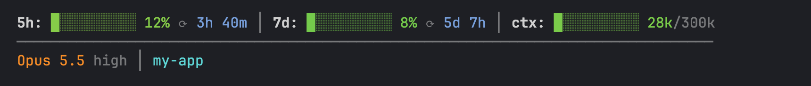
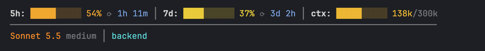
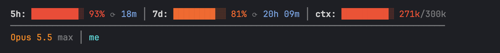
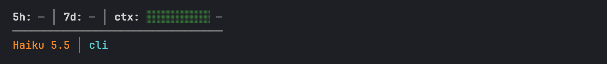

# claude-statusline

Строка статуса для [Claude Code](https://docs.claude.com/en/docs/claude-code/statusline): лимиты 5h/7d с временем до сброса, заполненность контекста, модель, effort и текущая папка. Один Python-файл без зависимостей.






- **5h / 7d** — использование лимитов, градиент зелёный → красный, `⟳` — сколько осталось до сброса
- **ctx** — токены в контексте относительно `CTX_CEIL` (по умолчанию 300k)
- **вторая строка** — модель, уровень effort, папка

## Установка

```sh
cp statusline.py ~/.claude/statusline.py
```

В `~/.claude/settings.json`:

```json
"statusLine": {
  "type": "command",
  "command": "python3 ~/.claude/statusline.py",
  "padding": 0
}
```

Нужен Python 3.12+ и терминал с truecolor.

## Проверка

```sh
python3 statusline.py < examples/mid.json
```

## Настройка

Константы в начале `statusline.py`: `CTX_CEIL` — потолок шкалы контекста, `BAR_W` — ширина шкал, `STOPS` — цвета градиента.
